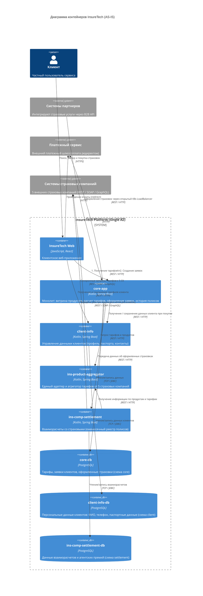

# Проектная работа: Архитектура InsureTech

Документация и архитектурный анализ платформы-агрегатора страховых услуг **InsureTech**.

---

## Содержание
1. [О компании и продукте](#1-о-компании-и-продукте)
2. [Бизнес-проблематика и ключевые вызовы](#2-бизнес-проблематика-и-ключевые-вызовы)
3. [Текущее состояние архитектуры (AS-IS)](#3-текущее-состояние-архитектуры-as-is)
   - [Компонентная модель (C4 Container Diagram)](#компонентная-модель-c4-container-diagram)
   - [Описание сервисов и инфраструктуры](#описание-сервисов-и-инфраструктуры)
   - [Анализ уязвимостей и «узких мест»](#анализ-уязвимостей-и-узких-мест)
4. [Требования и цели трансформации](#4-требования-и-цели-трансформации)
   - [Функциональные и нефункциональные требования (NFR)](#функциональные-и-нефункциональные-требования-nfr)
   - [SLA, SLO, SLI](#sla-slo-sli)
5. [Структура репозитория и заданий](#5-структура-репозитория-и-заданий)
6. [Инструменты и окружение](#6-инструменты-и-окружение)

---

## 1. О компании и продукте

**InsureTech** — быстрорастущая компания, предоставляющая агрегационные услуги в сфере страхования. Компания выступает единым цифровым шлюзом между клиентами (B2C/B2B) и страховыми компаниями (провайдерами полисов).

### Клиенты и каналы взаимодействия
* **B2C (Частные клиенты)**: Веб-сервис для быстрого подбора, сравнения и оформления страховых полисов.
* **B2B (Корпоративные клиенты и партнёры)**: Публичный API для встраивания страховых продуктов в сторонние сервисы, банки, ритейл и агрегаторы.
* **Основной продукт на текущем этапе**: Страхование жизни (с активным расширением на автострахование ОСАГО/КАСКО и другие виды полисов).

---

## 2. Бизнес-проблематика и ключевые вызовы

После успешного запуска MVP сервис столкнулся с классическими «болезнями роста»:

| Проблема | Проявление | Метрики / Масштаб | Влияние на бизнес |
|---|---|---|---|
| **Медленная загрузка страниц сайта** | Страницы открываются несколько минут или возвращают timeout при пиковой нагрузке. | Пик: 50 RPS (поиск/каталог), 10 RPS (оформление). | Падение конверсии, снижение NPS и коэффициента удержания (Retention). |
| **Нарушение SLA B2B-партнёров («Noisy Neighbor»)** | Партнёры фиксируют регулярные сбои и деградацию времени ответа API. | Один партнёр превысил квоту в 12.5 раз: генерировал до **250 RPS** вместо согласованных **20 RPS**, утилизировав все ресурсы ядра. | Риск потери ключевых B2B-партнёров, штрафные санкции, срыв коммерческих соглашений. |
| **Падения и недоступность сервиса** | Полная недоступность платформы, долгое восстановление (MTTR). Команда узнаёт об авариях от разгневанных пользователей, а не из систем мониторинга. | Стоимость простоя: **~500 000 руб./час**. | Прямые финансовые убытки, репутационный ущерб в СМИ, отток клиентов. |
| **Предстоящий маркетинговый всплеск** | Запланирована масштабная рекламная кампания с ожидаемым кратным притоком пользователей. | Ожидается рост нагрузки в разы. | В текущем состоянии инфраструктура не выдержит трафика — риск полного коллапса сервиса. |

---

## 3. Текущее состояние архитектуры (AS-IS)

### Компонентная модель (C4 Container Diagram)



### Описание сервисов и инфраструктуры

1. **`core-app` (Kotlin / Spring Boot)**:
   - Центральный монолит платформы.
   - Отвечает за предоставление каталога, расчет тарифов, оформление заявок и просмотр купленных полисов.
   - Обслуживает как B2C веб-клиентов, так и внешних B2B-партнёров через общий стек.
2. **`client-info` (Kotlin / Spring Boot)**:
   - Сервис профилей и персональных данных (ФИО, телефоны, паспортные данные).
   - Вызывается веб-клиентом напрямую из личного кабинета и `core-app` во время оформления заказа.
3. **`ins-product-aggregator` (Kotlin / Spring Boot)**:
   - Шлюз интеграции со сторонними страховыми компаниями (5 СК).
   - Транслирует внутренний формат в разнородные API провайдеров (REST, SOAP, GraphQL).
4. **`ins-comp-settlement` (Kotlin / Spring Boot)**:
   - Сервис расчетов агентских вознаграждений.
   - Раз в месяц агрегирует реестры проданных полисов и передает их в страховые компании.
5. **Инфраструктура**:
   - **Compute**: Кластер Kubernetes, развернутый в **одной зоне доступности** (Single AZ).
   - **Database**: Единственная виртуальная машина с СУБД PostgreSQL. Сервисы логически изолированы через схемы (`core`, `client`, `settlement`).
   - **Сетевой периметр**: Партнеры обращаются к API напрямую через публичный `LoadBalancer` Kubernetes без шлюзов безопасности и лимитирования.

---

### Анализ уязвимостей и «узких мест»

```
+-----------------------------------------------------------------------------------+
|                              КРИТИЧЕСКИЕ ТОЧКИ ОТКАЗА                             |
+-----------------------------------------------------------------------------------+
| 1. Единая точка отказа БД (SPOF)    -> PostgreSQL на одной ВМ без реплик и failover|
| 2. Отсутствие защиты от перегрузок  -> Прямой K8s LoadBalancer без API Gateway    |
| 3. Синхронные каскадные тайм-ауты   -> Опрос 5 внешних СК блокирует потоки core   |
| 4. Single-AZ инфраструктура         -> Сбой одного ДЦ останавливает весь бизнес   |
| 5. Отсутствие Observability         -> О падениях узнают от пользователей         |
| 6. Монолитная связность ресурсов    -> B2B трафик душит B2C пользователей         |
+-----------------------------------------------------------------------------------+
```

1. **Единая точка отказа (SPOF) в хранилище данных**:
   - PostgreSQL развернут в единственном экземпляре на одной ВМ.
   - Падение ВМ или деградация диска приводит к полному простою сервиса (500 000 руб./час).
   - Отсутствует репликация (Read Replicas), автоматический failover (Patroni / Managed DB) и верифицированные процедуры Disaster Recovery.
2. **Отсутствие API Gateway и Rate Limiting**:
   - API доступен напрямую через K8s LoadBalancer.
   - Нет механизма квотирования и ограничения запросов (Rate Limiting / Throttling).
   - Один недобросовестный партнер (250 RPS вместо 20 RPS) исчерпал Connection Pool к БД и пул потоков `core-app`, вызвав отказ в обслуживании для всех клиентов.
3. **Синхронная блокирующая интеграция со страховыми компаниями**:
   - При поиске страховок `ins-product-aggregator` синхронно опрашивает 5 внешних страховых систем (по REST/SOAP/GraphQL).
   - Задержка или зависание хотя бы одной внешней системы подвешивает цепочку вызовов `core-app`, вызывая истощение потоков (Thread Starvation) и минутные задержки страниц.
   - Отсутствуют Circuit Breakers, таймауты и асинхронный сбор предложений.
4. **Отсутствие кэширования**:
   - Нет слоя кэширования (Redis / KeyDB) для неизменяемых или медленно меняющихся данных (справочники, базовые тарифы, типовые предложения).
   - Каждый поисковый запрос (50 RPS) нагружает БД и внешние системы.
5. **Инфраструктурная ненадежность (Single AZ)**:
   - Все узлы K8s находятся в одной зоне доступности. Любой сетевой или аппаратный инцидент в дата-центре приводит к простою.
6. **Слепая зона эксплуатации (Lack of Observability)**:
   - Отсутствует сквозной сбор метрик (Prometheus), централизованный сбор логов и распределенный трейсинг (OpenTelemetry / Jaeger).
   - Отсутствует предиктивный и реактивный алертинг (Alertmanager), команда не знает о деградации сервиса в реальном времени.

---

## 4. Требования и цели трансформации

### Функциональные и нефункциональные требования (NFR)

* **Доступность (Availability)**: Не менее **99.9%** (максимальный простой не более 43 минут в месяц).
* **Масштабируемость (Scalability)**:
  * Поиск/витрина: горизонтальное масштабирование под нагрузку **до 500+ RPS** с автоскейлингом (HPA).
  * Оформление заказов: устойчивость к пикам **до 100+ RPS**.
* **Изоляция и защита (Fault Tolerance & Security)**:
  * Внедрение API Gateway с авторизацией по токенам/ключам и жестким Rate Limiting на уровне клиентов/партнеров.
  * Защита критического пути B2C от всплесков B2B.
  * Паттерны Circuit Breaker, Timeout, Fallback и Bulkhead для внешних интеграций.
* **Отказоустойчивость хранения (Data Resiliency)**:
  * Кластер PostgreSQL высокой доступности с синхронной/асинхронной репликацией в нескольких зонах доступности (Multi-AZ) и автоматическим failover.
* **Наблюдаемость (Observability)**:
  * Сбор системных и бизнес-метрик (Golden Signals: Latency, Traffic, Errors, Saturation).
  * Дашборды мониторинга и проактивный алертинг с уведомлением дежурных инженеров за время < 1 минуты после возникновения аномалии.

### SLA, SLO, SLI

| Область | SLI (Индикатор) | SLO (Целевой уровень) | SLA (Обязательство) |
|---|---|---|---|
| **Доступность B2C веб-портала** | Доля успешных ответов (HTTP 2xx/3xx) на шлюзе | 99.95% в месяц | 99.9% доступности |
| **Время ответа поиска (B2C)** | 95-й процентиль задержки (Latency p95) | p95 < 800 мс | p95 < 2.0 сек |
| **Доступность B2B API** | Доля успешных ответов в пределах согласованного рейт-лимита | 99.99% в месяц | 99.95% (с фин. компенсацией) |
| **Время ответа B2B API** | 99-й процентиль задержки (Latency p99) | p99 < 500 мс | p99 < 1.5 сек |
| **Реакция на инциденты (MTTA/MTTR)** | Время обнаружения (MTTA) / время восстановления (MTTR) | MTTA < 3 мин, MTTR < 15 мин | Реакция < 10 мин |

---

## 5. Структура репозитория и заданий

Решение проектной работы разбито на 6 логических этапов (заданий):

```
architecture-insuretech/
├── README.md               # Архитектурное описание проекта и контекст
├── Task1/                  # Задание 1: Анализ узких мест, разработка архитектурных решений
├── Task2/                  # Задание 2: Проектирование API Gateway, квотирование и Rate Limiting
├── Task3/                  # Задание 3: Отказоустойчивость инфраструктуры (Multi-AZ, HA DB)
├── Task4/                  # Задание 4: Оптимизация интеграций со страховыми (Асинхронность, Circuit Breakers)
├── Task5/                  # Задание 5: Проектирование системы наблюдаемости (Observability, Alerting)
└── Task6/                  # Задание 6: Нагрузочное тестирование и валидация целевой архитектуры
```

Каждое задание содержит необходимые архитектурные диаграммы (C4, схемы взаимодействия), конфигурационные файлы, манифесты Kubernetes/Nginx, схемы API (OpenAPI/GraphQL) и скрипты тестирования.

---

## 6. Инструменты и окружение

Для выполнения и проверки заданий используются следующие инструменты:
* **Моделирование архитектуры**: [draw.io](https://app.diagrams.net/) со специальными библиотеками иконок [Yandex Cloud Services](https://code.s3.yandex.net/software-architect/Yandex_Cloud_services_oct_23.xml?etag=2b1ed124cee4731d14f2691b9a187e45) и [Yandex Cloud Containers](https://code.s3.yandex.net/software-architect/Yandex-Cloud-containers_oct_23.drawio.xml?etag=1434877819f05ab6c6ff90662ca6a1a0).
* **Локальный оркестратор**: [Minikube](https://kubernetes.io/ru/docs/tasks/tools/install-minikube/) и CLI-утилита [Kubectl](https://kubernetes.io/ru/docs/tasks/tools/install-kubectl/).
* **Нагрузочное тестирование**: [Python 3](https://www.python.org/downloads/) + [Locust](https://locust.io/).
* **Спецификации и конфигурации**: OpenAPI (Swagger), GraphQL Schemas, Nginx Configurations, K8s Manifests.
