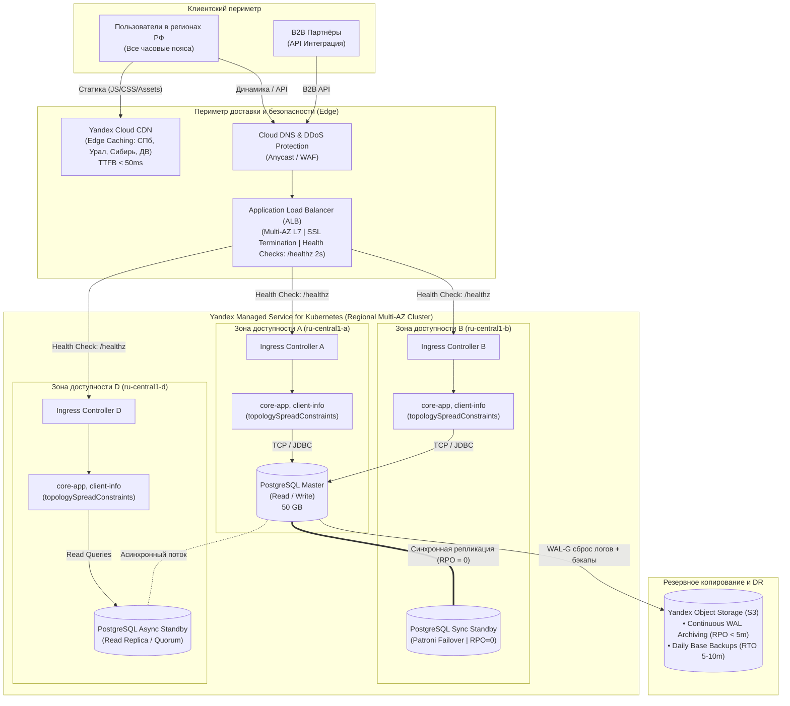

# Задание 1: Проектирование целевой технологической архитектуры (TO-BE)

Документация и обоснование архитектурных решений для платформы **InsureTech** в рамках региональной экспансии по РФ.

---

## 1. Контекст бизнеса и цели трансформации

Компания **InsureTech** выходит на этап масштабной региональной экспансии по всей территории Российской Федерации. Бизнес ожидает кратный рост аудитории и входящих запросов, а также непрерывное обслуживание клиентов во всех 11 часовых поясах России в режиме 24/7.

### Ключевые требования бизнеса:

| Требование | Значение | Обоснование и влияние на архитектуру |
|:---|:---:|:---|
| **Доступность (Availability)** | **99.9%** | Допустимый совокупный простой системы — не более **43.8 минут в месяц** (или ~8.76 часов в год). Исключает использование Single-AZ решений. |
| **RTO (Recovery Time Objective)** | **&le; 45 мин.** | Максимально допустимое время восстановления полной работоспособности сервиса после аварии. |
| **RPO (Recovery Point Objective)** | **&le; 15 мин.** | Максимально допустимый объём потерянных данных при катастрофическом сбое. |
| **Пользовательский опыт в регионах РФ** | **Одинаковый TTFB** | Время загрузки страниц не должно зависеть от географического положения (от Калининграда до Владивостока). Требует выноса статики на периметр (CDN). |
| **Текущий объём данных** | **50 GB** | Базовая информация о клиентах (ФИО, контакты, документы), продукты и тарифы, история заявок. Не требует шардирования, критичен для быстрого восстановления. |

---

## 2. Анализ исходного состояния (AS-IS) и уязвимости

В исходном состоянии архитектура сервиса имеет критические конструктивные дефекты:

```
[Пользователь (Браузер)] 
         │ (Прямой TCP)
         ▼
[Зона доступности 1]
   ┌────────────────────────────────────────────────────────┐
   │ Kubernetes cluster 1 (VM 1)                            │
   │   └─ Namespace InsureTech (все сервисы)                │
   │               │ (TCP)                                  │
   │               ▼                                        │
   │ PostgreSQL (Master) на той же ВМ                       │
   └────────────────────────────────────────────────────────┘
```

### Выявленные критические точки отказа:
1. **Single Point of Failure (SPOF) инфраструктуры**: Все компоненты развернуты в **одной зоне доступности** (Single AZ). Авария в дата-центре приводит к полной недоступности сервиса с нарушением SLA 99.9%.
2. **Единая точка отказа БД**: PostgreSQL работает в единственном экземпляре (Master) без репликации, без автоматического failover и без распределенного резервного копирования. Любой сбой диска или ОС приводит к превышению RTO 45 мин.
3. **Отсутствие CDN и пограничной оптимизации**: Пользователи из Сибири и Дальнего Востока вынуждены скачивать все JS/CSS бандлы и изображения с серверов в Центральном регионе, что дает задержки (RTT) в сотни миллисекунд.
4. **Сетевой периметр без защиты и балансировки**: Входящий трафик поступает напрямую на Kubernetes без L7 балансировки, без распределения по зонам, без WAF и DDoS-защиты.

---

## 3. Целевая архитектура (TO-BE) и ключевые решения

### 3.1. Стратегия масштабирования и отказоустойчивости

#### Сравнение стратегий масштабирования:

| Критерий | Вертикальное масштабирование (Scale-Up) | Горизонтальное масштабирование (Scale-Out) | Выбор для InsureTech |
|:---|:---|:---|:---:|
| **Уровень приложений (Stateless)** | Требует перезапуска подов/узлов, имеет аппаратный потолок, не защищает от сбоя железа. | Динамическое добавление реплик (HPA), нулевой простой, автоматическая балансировка нагрузки. | **Горизонтальное (Scale-Out)** |
| **Уровень БД (Stateful, 50 GB)** | Эффективно, дешево и просто для 50 GB. Позволяет держать всю БД в RAM (Buffer Pool). | Шардирование для 50 GB не требуется; репликация на чтение (Read Replicas) для масштабирования запросов. | **Scale-Up + Репликация на чтение** |

#### Зоны доступности:
Для соблюдения SLA **99.9%** система разворачивается в **трех независимых зонах доступности (Multi-AZ)** облачной платформы Yandex Cloud:
* `ru-central1-a`
* `ru-central1-b`
* `ru-central1-d`

Каждая зона доступности расположена в изолированном дата-центре с независимым электроснабжением, охлаждением и каналами связи. Выход из строя любого одного ДЦ не приводит к деградации сервиса.

---

### 3.2. Конфигурация развёртывания в Kubernetes

#### Сравнение подходов:

| Параметр | Независимые кластеры в каждой площадке | Региональный (растянутый) кластер |
|:---|:---|:---|
| **Управление (Control Plane)** | 3 независимых мастера, необходимость координации конфигураций. | **Единый высокодоступный Control Plane** (кворум etcd в 3 AZ), управляемый Yandex Cloud (SLA 99.95%). |
| **CI/CD и деплой** | Сложный многокластерный пайплайн, риск рассинхронизации версий. | **Единый стандартный пайплайн**, атомарный деплой во все зоны. |
| **Сетевая связность** | Требуется сложный Multi-Cluster Service Mesh (Istio / Submariner). | Нативная маршрутизация Kubernetes (CoreDNS, Calico, Kube-Proxy). |
| **Балансировка подов** | Ручное распределение реплик между кластерами. | **`topologySpreadConstraints`** автоматически распределяет поды по зонам `topology.kubernetes.io/zone`. |
| **Самовосстановление (Failover)** | Ручное или внешнее переключение GSLB. | **Автоматический перезапуск подов** на выживших нодах за 1–2 минуты. |

> **Архитектурное решение**: Выбран **один региональный (растянутый) кластер Yandex Managed Service for Kubernetes**.
> 
> *Обоснование*: Требование RTO &le; 45 мин. и доступность 99.9% полностью перекрываются региональным кластером. Независимые кластеры внесли бы избыточную сложность эксплуатации (Overengineering) и риски человеческого фактора при синхронизации конфигураций.

```yaml
# Пример спецификации равномерного распределения подов по 3 зонам доступности:
spec:
  topologySpreadConstraints:
    - maxSkew: 1
      topologyKey: "topology.kubernetes.io/zone"
      whenUnsatisfiable: DoNotSchedule
      labelSelector:
        matchLabels:
          app: core-app
```

---

### 3.3. Балансировка нагрузки и ускорение для регионов РФ

#### 1. Yandex Cloud CDN (Edge Caching):
* Проблема регионов РФ: Расстояние между Калининградом и Владивостоком превышает 7 000 км, физический сетевой пинг (RTT) составляет 120–160 мс.
* Решение: Геораспределенная сеть доставки контента (CDN) с точками присутствия (PoPs) в ключевых хабах РФ (Санкт-Петербург, Екатеринбург, Новосибирск, Владивосток, Краснодар и др.).
* На CDN кэшируется вся статика веб-приложения: SPA бандлы (JS, CSS), веб-шрифты, логотипы, промо-материалы, статичные каталоги базовых тарифов.
* **Результат**: Время первой отрисовки (FCP) и загрузки (TTFB) составляет **&lt; 50 мс для любого региона РФ**, независимо от расстояния до центрального ЦОД.

#### 2. Yandex Application Load Balancer (ALB) — L7 Multi-AZ:
* Внешний балансировщик с Anycast IP, терминирующий HTTPS-трафик во всех 3 зонах доступности.
* Интеграция с Yandex Certificate Manager (автоматическая ротация Let's Encrypt SSL-сертификатов).
* Встроенная защита периметра: Anti-DDoS (L3–L4) и Web Application Firewall (WAF, L7).
* Маршрутизация на базе путей (Path-based Routing):
  * `/static/*`, `/_next/*` &rarr; CDN / Object Storage
  * `/api/v1/*`, `/graphql` &rarr; Ingress Controllers в Kubernetes

#### 3. Health Checks (Проверки работоспособности):
* **Внешний уровень (ALB &rarr; Ingress Nodes)**:
  * Запрос: `HTTP GET /healthz`
  * Интервал опроса: **2 секунды**, таймаут ожидания: **1 секунда**.
  * Порог отказа: **2 последовательных сбоя** (unhealthy threshold).
  * Порог восстановления: **2 успешных ответа** (healthy threshold).
  * *Поведение при сбое*: Если нода или зона перестает отвечать за 4 секунды, ALB мгновенно исключает её из балансировки и направляет весь трафик на здоровые зоны доступности.
* **Внутренний уровень (Kubernetes Probes)**:
  * `livenessProbe` (`/healthz/liveness`): проверка подвисания процесса/JVM; при отсутствии ответа K8s перезапускает контейнер.
  * `readinessProbe` (`/healthz/readiness`): проверка готовности принимать запросы (пулы соединений к БД, прогрев кэша); при сбое под временно исключается из Endpoints.
  * `startupProbe`: дает запас времени для старта и инициализации Spring Boot контекста.

---

### 3.4. Архитектура хранилища данных и отказ от шардирования

#### Вопрос шардирования БД:
> **Решение: Шардирование НЕ применяется.**
> 
> **Обоснование**:
> 1. Текущий объём всей базы данных составляет **всего 50 GB**.
> 2. Современный сервер PostgreSQL (например, 8–16 vCPU, 32–64 GB RAM, быстрые сетевые NVMe SSD) с легкостью обрабатывает единые базы данных объёмом до **2–5 ТБ** и до тысяч транзакций в секунду (TPS).
> 3. Введение шардирования при объеме 50 GB создало бы катастрофические накладные расходы: необходимость распределенных транзакций (2PC), потерю поддержки внешних ключей (Foreign Keys) между клиентами, заявками и договорами, усложнение аналитических запросов и кратное увеличение RTO при восстановлении.
> 4. При будущем росте истории заявок (через несколько лет) масштабирование будет решаться **декларативным секционированием (Partitioning by Range)** по дате оформления заявок внутри одного кластера.

#### Конфигурация кластера СУБД:
Используется **Yandex Managed Service for PostgreSQL** в конфигурации высокой доступности (HA) на 3 зоны доступности:

```
            [Клиентские сервисы K8s]
                        │
                        ▼ (PgBouncer Pool)
        ┌────────────────────────────────┐
        │       PostgreSQL Master        │ (Зона A: ru-central1-a)
        │         (Read / Write)         │
        └───────┬────────────────┬───────┘
                │                │
(Sync Replication)      (Async Streaming)
        RPO = 0                  │
                ▼                ▼
┌───────────────────────┐ ┌───────────────────────┐
│  Synchronous Standby  │ │  Asynchronous Standby │
│ (Зона B: ru-central1) │ │ (Зона D: ru-central1) │
│ Auto-Failover Patroni │ │ Read-Only / Reporting │
└───────────────────────┘ └───────────────────────┘
```

1. **Master (ru-central1-a)**: Принимает все транзакции на запись и критичные к актуальности чтения.
2. **Synchronous Standby (ru-central1-b)**: Синхронная реплика. Каждая транзакция подтверждается только после фиксации на диске реплики. **Гарантирует RPO = 0**.
3. **Asynchronous Standby (ru-central1-d)**: Асинхронная реплика для тяжелых отчетов (расчеты агентских премий `ins-comp-settlement`), обеспечивает кворум 3 узлов для выбора нового лидера.
4. **Оркестрация отказоустойчивости**: Встроенный механизм на базе **Patroni** и распределенного консенсуса (etcd).

#### Стратегия резервного копирования и Disaster Recovery:
* **Continuous WAL Archiving (WAL-G)**: Потоковый сброс журналов предзаписи (WAL) в геораспределенное объектное хранилище **Yandex Object Storage (S3)** каждые несколько секунд/минут.
  * Обеспечивает возможность восстановления на любую секунду (**Point-in-Time Recovery, PITR**).
  * Гарантирует соблюдение требования **RPO &le; 15 мин.** (фактический RPO &lt; 5 минут даже при гибели всего кластера).
* **Daily Base Backups**: Ежедневные полные снапшоты базы данных с хранением 30 дней в S3.
* **Расчет времени восстановления (RTO)**:
  * База объемом **50 GB** восстанавливается из S3 по внутренней шине облака со скоростью &gt; 150 МБ/с за **~5–8 минут**.
  * Накатка инкрементальных WAL за последние часы занимает еще **~3–5 минут**.
  * Суммарный аварийный RTO при полном пересоздании кластера составляет **~10–15 минут**, что с трехкратным запасом укладывается в требование **RTO &le; 45 минут**.

---

### 3.5. Фейловер-стратегия (Failover)

| Уровень | Сценарий сбоя | Механизм обнаружения | Действие системы | Фактическое время (RTO) | Потеря данных (RPO) |
|:---|:---|:---|:---|:---:|:---:|
| **Под / Контейнер** | Зависание Spring Boot приложения | Kubernetes `livenessProbe` (3 неудачи) | Автоматический рестарт пода kubelet | &lt; 30 сек | 0 (Stateless) |
| **Рабочая нода** | Аппаратный сбой ВМ | K8s Node Controller (NotReady 40s) | Перезапуск подов на других узлах кластера | 1–2 мин | 0 |
| **Зона доступности (ДЦ)** | Падение дата-центра / сети | ALB Health Check (2 сбоя &times; 2с = 4с) | Исключение зоны из ALB, маршрутизация в оставшиеся 2 AZ | 4–10 сек | 0 |
| **PostgreSQL Master** | Сбой основного узла БД | Patroni / etcd heartbeat (10с) | Автоматический промоушен Synchronous Standby в Master | **15–30 сек** | **0** |
| **Катастрофа кластера** | Повреждение данных / авария | Системный алерт мониторинга | Восстановление кластера из WAL-G S3 (PITR) | **10–15 мин** | **&lt; 5 мин** |

Все сценарии полностью удовлетворяют целевым показателям бизнеса:
* **SLA 99.9%**: достигается за счет активной работы 3 зон (Active-Active) и быстрого переключения.
* **RTO &le; 45 мин**: фактическое время восстановления при штатных авариях &lt; 1 мин, при катастрофах &lt; 15 мин.
* **RPO &le; 15 мин**: при failover на синхронную реплику **RPO = 0**, при откате из архивов S3 **RPO &lt; 5 мин**.

---

## 4. Схемы архитектуры (AS-IS и TO-BE)

### Файлы схем для draw.io:
* **Исходная архитектура (AS-IS)**: [InureTech_технологическая архитектура_as-is.drawio](file:///c:/Users/kosty/Desktop/yandex%20courses/architecture-insuretech/Task1/InureTech_технологическая%20архитектура_as-is.drawio)
* **Целевая архитектура (TO-BE)**: [InureTech_технологическая архитектура_to-be.drawio](file:///c:/Users/kosty/Desktop/yandex%20courses/architecture-insuretech/Task1/InureTech_технологическая%20архитектура_to-be.drawio)

### Структурная схема целевого решения (TO-BE):



---

## 5. Как открыть и работать со схемой в draw.io

1. Откройте [draw.io (app.diagrams.net)](https://app.diagrams.net/) в браузере или запустите десктопное приложение.
2. Выберите **Файл (File)** &rarr; **Открыть из (Open from)** &rarr; **Устройство (Device)**.
3. Выберите файл [InureTech_технологическая архитектура_to-be.drawio](file:///c:/Users/kosty/Desktop/yandex%20courses/architecture-insuretech/Task1/InureTech_технологическая%20архитектура_to-be.drawio) из директории `Task1`.
4. На схеме отражены все зоны доступности, балансировщики, проверки здоровья, кластер БД, репликация, резервное копирование и подробные выносные комментарии по каждому архитектурному вопросу.
