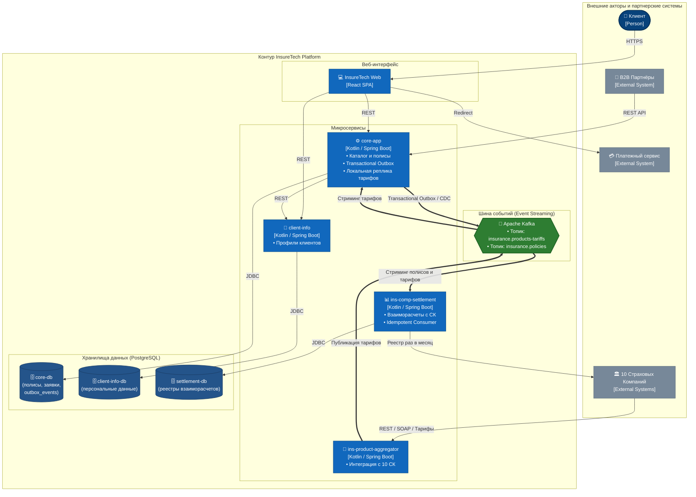

# Задание 3. Переход на Event-Driven архитектуру

## 1. Проблемы текущей схемы (AS-IS) и риски

При расширении партнерской сети с 5 до 10 страховых компаний (СК) синхронная архитектура создает критические узкие места:

1. **Каскадная деградация (`ins-product-aggregator`)**: Синхронный опрос всех СК блокирует потоки. Сбой или задержка даже одной из 10 компаний парализует получение тарифов.
2. **Неактуальность тарифов (Data Staleness)**: Опрос раз в 15 минут приводит к расхождению цен на витрине с реальными тарифами СК и отказам при оформлении.
3. **Ночные пики и риск OOM (`core-app` &rarr; `ins-comp-settlement`)**: Передача всех оформленных за сутки полисов одним «тяжелым» REST-запросом перегружает память JVM, грозит сбоями по OOM и долгими блокировками БД.
4. **Проблема двойной записи (Dual-Write)**: Прямой вызов внешнего сервиса или брокера из транзакции сохранения полиса приводит к рассинхронизации данных при сетевых сбоях.

| Риск | Уровень | Последствия | Решение |
|---|:---:|---|---|
| Сбой/задержка 1 из 10 СК | **Критический** | Недоступность витрины продуктов | Асинхронный сбор тарифов + шина событий Kafka |
| Data Staleness (задержка 15 мин) | **Высокий** | Отказы в оформлении полисов | Стриминг изменений тарифов в реальном времени |
| Падение `core-app` по OOM ночью | **Критический** | Срыв формирования реестров для СК | Непрерывный потоковый учет полисов |
| Потеря данных о продажах (Dual-Write) | **Критический** | Финансовые расхождения и штрафы | Паттерн **Transactional Outbox** (гарантия At-least-once) |

---

## 2. Целевая архитектура (TO-BE: Apache Kafka)

Межсервисное взаимодействие переводится на событийную модель через **Apache Kafka**.

```
[10 Страховых Компаний] 
         │ (Webhooks / Асинхронный опрос)
         ▼
[ins-product-aggregator] ──(Producer)──► [Топик: insurance.products-tariffs] ──(Consumer)──► [core-app] & [settlement]
                                                                                              (локальные реплики тарифов)

[core-app] ──(Transactional Outbox)──► [Топик: insurance.policies] ──(Consumer)──► [ins-comp-settlement]
                                                                                     (поточный учет полисов)
```

### Спецификация топиков:
1. **`insurance.products-tariffs`** (паттерн *Event-Carried State Transfer*):
   - **Продюсер**: `ins-product-aggregator`.
   - **Потребители**: `core-app` (актуализация цен на витрине) и `ins-comp-settlement`.
   - **Конфигурация**: `cleanup.policy=compact`, ключ `company_id:product_id`.
2. **`insurance.policies`** (Domain Event: `PolicyIssued`):
   - **Продюсер**: `core-app` через Transactional Outbox.
   - **Потребитель**: `ins-comp-settlement` (непрерывный расчет комиссий без ночных батчей).
   - **Конфигурация**: ключ `policy_id`, хранение 30 дней (`retention.ms`).

---

## 3. Проектирование Transactional Outbox

Для гарантированной доставки информации о проданных полисах без Dual-Write внедрен паттерн **Transactional Outbox**:

1. **Атомарная запись**: При оформлении полиса `core-app` в рамках **одной ACID-транзакции** сохраняет запись в таблицу `policies` и формирует событие в таблице `outbox_events` базы `core-db`.
2. **Ретрансляция (CDC / Debezium)**: Коннектор Debezium считывает события из журнала транзакций PostgreSQL (WAL) и публикует их в Kafka-топик `insurance.policies` с гарантией **At-least-once**.
3. **Идемпотентный потребитель**: В `ins-comp-settlement` настроен `Idempotent Consumer` (уникальный индекс по `policy_id`), исключающий повторные начисления при дублировании сообщений.

```sql
-- Таблица Outbox в core-db
CREATE TABLE outbox_events (
    id UUID PRIMARY KEY DEFAULT gen_random_uuid(),
    aggregate_type VARCHAR(64) NOT NULL, -- 'POLICY'
    aggregate_id VARCHAR(64) NOT NULL,   -- 'POL-12345'
    event_type VARCHAR(64) NOT NULL,     -- 'POLICY_ISSUED'
    payload JSONB NOT NULL,
    created_at TIMESTAMP WITH TIME ZONE DEFAULT NOW() NOT NULL,
    processed BOOLEAN DEFAULT FALSE NOT NULL
);
```

---

## 4. Диаграмма контейнеров (C4 Container Diagram)

Файл схемы draw.io: [Task3/InsureTech_C4_container-diagram.drawio](InsureTech_C4_container-diagram.drawio)

### Ключевые изменения схемы:
* Введен центральный контейнер **Apache Kafka** (буферизация событий полисов и тарифов).
* Устранены 3 синхронных REST-зависимости (периодический поллинг и ночной экспорт).
* Партнерский пул расширен до **10 страховых компаний**.
* В `core-db` зафиксирована таблица `outbox_events`.



---

## 5. Сравнение архитектур AS-IS и TO-BE

| Характеристика | Текущее состояние (AS-IS) | Целевое состояние (TO-BE) |
|---|---|---|
| **Связность (Coupling)** | Жесткая синхронная (сбой СК или сервиса ведет к каскадным авариям). | Слабая асинхронная через Kafka (изоляция сбоев). |
| **Актуальность витрины** | Задержка до 15 минут (поллинг). | Мгновенно (< 1 сек через Event-Carried State Transfer). |
| **Нагрузка на `core-app`** | Тяжелые ночные REST-выгрузки, риск OOM. | Равномерный непрерывный поток событий без пиков памяти. |
| **Надежность данных** | Риск потери при сбоях сети (Dual-Write). | 100% гарантия доставки (**At-least-once**) через Outbox. |
| **Масштабируемость** | Ограничена синхронными цепочками вызовов. | Независимое масштабирование продюсеров и консьюмеров. |
