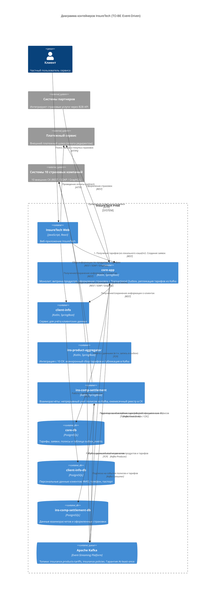

# Задание 3. Переход на Event-Driven архитектуру

---

## 1. Введение и бизнес-контекст

Платформа **InsureTech** выступает связующим звеном между клиентами (B2C/B2B) и страховыми компаниями (СК). На текущем этапе платформа интегрирована с **5 страховыми компаниями**. В ближайших планах бизнеса — подключение ещё **5 новых страховых компаний** (суммарно 10 СК), выход в новые регионы РФ и проведение федеральной рекламной кампании, что вызовет многократный рост количества пользователей и операций.

Настоящий документ содержит комплексный архитектурный анализ текущего состояния (AS-IS), реестр рисков при планируемом росте нагрузки, обоснование перехода на событийно-ориентированную архитектуру (**Event-Driven Architecture / Event-Streaming**), детальное описание паттерна **Transactional Outbox**, а также обновленную **C4 Container Diagram**.

---

## 2. Анализ текущей архитектуры (AS-IS) и выявленные проблемы

В текущей архитектуре обмен ключевыми данными между сервисами `core-app`, `ins-comp-settlement` и `ins-product-aggregator` построен на **синхронных REST-запросах** и **периодическом опросе (Polling)**:
1. `core-app` запрашивает данные о продуктах и тарифах у `ins-product-aggregator` раз в 15 минут по расписанию.
2. `ins-comp-settlement` запрашивает данные о продуктах и тарифах у `ins-product-aggregator` один раз в сутки (ночью).
3. `ins-product-aggregator` в момент каждого вызова синхронно опрашивает все внешние страховые компании (сейчас 5 СК), объединяет ответы и возвращает единый список.
4. `ins-comp-settlement` один раз в сутки (ночью) выполняет «тяжелый» REST-запрос в `core-app` для получения всего массива оформленных за день страховок.

```
+---------------------------------------------------------------------------------------------------------+
|                                    ТЕКУЩАЯ СХЕМА ВЗАИМОДЕЙСТВИЯ (AS-IS)                                  |
+---------------------------------------------------------------------------------------------------------+
|                                                                                                         |
|   [core-app] -------- REST (каждые 15 мин) -------> [ins-product-aggregator]                            |
|       |                                                    |                                            |
|       | (REST раз в сутки ночью:                           | (Синхронный опрос всех СК в момент вызова) |
|       |  все полисы за день)                               v                                            |
|       +---------------------------------------------> [5 Страховых Компаний]                            |
|       v                                                                                                 |
|   [ins-comp-settlement] ---- REST (раз в сутки) ---> [ins-product-aggregator]                            |
|                                                                                                         |
+---------------------------------------------------------------------------------------------------------+
```

### Проблема 1. Блокирующий синхронный Fan-Out и каскадная деградация (ins-product-aggregator)
В момент вызова `ins-product-aggregator` синхронно опрашивает все внешние системы страховых компаний.
- **Математика падения доступности**:
  Доступность синхронной цепочки равна произведению доступностей каждого из внешних звеньев:
  $$A_{total} = \prod_{i=1}^{N} A_i$$
  Если средняя доступность API каждой страховой компании составляет $A = 0.98$ (98%), то:
  - При 5 СК: $A_{total} = 0.98^5 \approx 90.39\%$ (простой системы более 70 часов в месяц!).
  - При 10 СК: $A_{total} = 0.98^{10} \approx 81.71\%$ (система будет недоступна или возвращать ошибки почти 20% времени!).
- **Ограничение по задержке (Latency Bottleneck)**:
  Время ответа агрегатора определяется самой медленной страховой компанией:
  $$T_{resp} = \max(t_1, t_2, \dots, t_N) + t_{internal}$$
  Если хотя бы у одной из 10 компаний возникнет спайк задержки (например, ответ займет 10–15 секунд), весь агрегированный ответ зависает.
- **Истощение пула потоков (Thread Starvation)**:
  В ожидании внешних ответов блокируются рабочие потоки веб-сервера (Tomcat) и соединения пула в `core-app` и `ins-product-aggregator`. Это быстро приводит к каскадному исчерпанию ресурсов и отказу всей системы.

### Проблема 2. Неактуальность данных (Data Staleness & Drift) при поллинге
- **Разрыв во времени в 15 минут (`core-app`)**: Если страховая компания меняет условия тарифа, вводит скидку или отзывает продукт, `core-app` узнает об этом с задержкой до 15 минут.
- **Отказы андеррайтинга при покупке**: Клиент видит на сайте устаревший тариф, нажимает «Оформить», отправляет оплату, а при финализации в СК запрос отклоняется, так как тариф уже недействителен. Это приводит к прямой потере конверсии, разочарованию пользователя и падению NPS.
- **Суточная задержка (`ins-comp-settlement`)**: Сервис взаиморасчетов обновляет справочник тарифов лишь ночью. В течение дня происходят продажи, а расчет комиссий и взаиморасчетов опирается на устаревшие данные.

### Проблема 3. Пакетная перегрузка монолитным запросом (Batch REST Request)
Раз в сутки ночью `ins-comp-settlement` запрашивает у `core-app` по REST API весь суточный объем оформленных страховок:
- **Риск Out-Of-Memory (OOM)**: При росте бизнеса до десятков и сотен тысяч оформленных полисов в день сериализация огромного JSON-ответа приводит к взрывному потреблению оперативной памяти и падению JVM по `java.lang.OutOfMemoryError: Java heap space`.
- **Длинные блокировки БД**: Запрос за большим диапазоном данных создает тяжелую нагрузку на `core-db`, блокируя операции записи и вытесняя горячие страницы из буферного кэша.
- **Сетевые таймауты (HTTP 504 / Connection Reset)**: Передача сотен мегабайт по HTTP уязвима к сбоям сети. При разрыве соединения транзакция прерывается, и `ins-comp-settlement` вынужден перезапрашивать весь массив повторно, создавая вторичную пиковую нагрузку.
- **Отсутствие точек возобновления**: В REST-запросе нет стандартного механизма докачки или курсора — сбой на 99% означает повторение всей процедуры.

### Проблема 4. Проблема двойной записи (Dual-Write Problem)
Попытка решить проблему путем прямого вызова REST API `ins-comp-settlement` из `core-app` в момент покупки полиса приводит к классической проблеме двойной записи:
- Если сохранить полис в БД, а сетевой REST-вызов в `ins-comp-settlement` упадет по таймауту — данные о продаже потеряются для взаиморасчетов (недостача выручки и штрафы от СК).
- Если сначала вызвать REST, а транзакция в БД `core-app` откатится — `ins-comp-settlement` учтет «фантомный» полис, за который клиент не заплатил.
- Распределенные транзакции (2PC / XA) не поддерживаются гетерогенными сервисами и катастрофически снижают производительность.

---

## 3. Реестр и матрица рисков при масштабировании до 10 СК

| № | Риск | Вероятность | Влияние | Уровень | Последствия для бизнеса | Архитектурная мера противодействия |
|---|---|---|---|---|---|---|
| **R1** | **Каскадный отказ `ins-product-aggregator` из-за сбоя 1 из 10 СК** | **Высокая** | **Критическое** | **КРИТИЧЕСКИЙ** | Остановка обновления тарифов, ошибки на витрине, недоступность сервиса. | Переход на асинхронный сбор данных с Circuit Breaker и публикация событий в Apache Kafka. |
| **R2** | **Отказы оформления полисов из-за рассинхронизации тарифов (Data Staleness)** | **Высокая** | **Высокое** | **ВЫСОКИЙ** | Падение конверсии продаж, негативные отзывы клиентов, снижение NPS. | Непрерывный стриминг изменений (Event-Carried State Transfer) в Kafka в реальном времени (< 1 сек). |
| **R3** | **Падение `core-app` по OOM при ночной выгрузке реестра в settlement** | **Высокая** | **Критическое** | **КРИТИЧЕСКИЙ** | Ночные аварии, невозможность сформировать реестры для СК, штрафы от партнеров. | Потоковая отправка каждого оформленного полиса как события в Kafka сразу в момент совершения сделки. |
| **R4** | **Потеря данных о проданных полисах при сбоях сети/сервисов (Dual-Write)** | **Средняя** | **Критическое** | **КРИТИЧЕСКИЙ** | Финансовые расхождения, потеря агентских комиссий, искажение финотчетности. | Внедрение паттерна **Transactional Outbox** в `core-app` с гарантией доставки **At-least-once**. |
| **R5** | **Исчерпание соединений и пула потоков при синхронном поллинге раз в 15 минут** | **Высокая** | **Высокое** | **ВЫСОКИЙ** | Спайки задержки, деградация производительности сайта для обычных покупателей. | Полный отказ от периодического REST-поллинга в пользу подписки на топики брокера. |
| **R6** | **Дублирование начислений при повторной доставке сообщений** | **Средняя** | **Среднее** | **СРЕДНИЙ** | Некорректные взаиморасчеты с контрагентами. | Реализация паттерна **Idempotent Consumer** на стороне `ins-comp-settlement`. |

---

## 4. Целевая архитектура (TO-BE Event-Driven Architecture)

Для устранения выявленных проблем проектируется переход на **Event-Driven Architecture (EDA)** с использованием **Apache Kafka** в качестве распределенной платформы потоковой передачи событий (Event Streaming Platform).

Декомпозиция бизнес-функциональности между микросервисами сохраняется неизменной, однако ключевые межсервисные взаимодействия переводятся с синхронного REST на асинхронный Event-Streaming.

```
+---------------------------------------------------------------------------------------------------------+
|                                    ЦЕЛЕВАЯ СХЕМА ВЗАИМОДЕЙСТВИЯ (TO-BE)                                 |
+---------------------------------------------------------------------------------------------------------+
|                                                                                                         |
|   [10 Страховых Компаний]                                                                               |
|             | (Webhooks / Асинхронный опрос)                                                            |
|             v                                                                                           |
|   [ins-product-aggregator]                                                                              |
|             |                                                                                           |
|             | [Kafka Producer]                                                                          |
|             v                                                                                           |
|   ================================= APACHE KAFKA =================================                      |
|   ||                                                                            ||                      |
|   ||  Топик: insurance.products-tariffs (Event-Carried State Transfer)          ||                      |
|   ||  Топик: insurance.policies (Domain Events: PolicyIssued)                   ||                      |
|   ||                                                                            ||                      |
|   ================================================================================                      |
|        |                               |                                   ^                            |
|        | [Consumer]                    | [Consumer]                        | [Outbox Relay / CDC]       |
|        v                               v                                   |                            |
|   [core-app]                  [ins-comp-settlement]                 [core-app / core-db]                |
|   (Локальная реплика          (Локальный реестр                     (Transactional Outbox:               |
|    тарифов в core-db)          в settlement-db)                      атомарно с полисом)                |
|                                                                                                         |
+---------------------------------------------------------------------------------------------------------+
```

### 4.1. Спецификация топиков Kafka

#### Топик 1: `insurance.products-tariffs`
- **Назначение**: Распространение информации об изменениях страховых продуктов, условий и тарифов (паттерн **Event-Carried State Transfer**).
- **Продюсер**: `ins-product-aggregator`.
- **Потребители (Consumer Groups)**:
  - `core-app-product-sync` (сервис `core-app`): обновляет локальную реплику тарифов в `core-db` для мгновенного отображения клиентам.
  - `settlement-product-sync` (сервис `ins-comp-settlement`): обновляет условия взаиморасчетов в `ins-comp-settlement-db`.
- **Ключ партиционирования (`message.key`)**: `company_id:product_id` (гарантирует строгий порядок обновлений по конкретному продукту).
- **Политика очистки**: `cleanup.policy=compact` (Kafka Log Compaction сохраняет последнее актуальное состояние для каждого продукта).

**Пример структуры события (`ProductUpdatedEvent`)**:
```json
{
  "eventId": "e4b3c2a1-89ab-4cde-0123-456789abcdef",
  "eventType": "PRODUCT_TARIFF_UPDATED",
  "timestamp": "2026-10-01T12:00:00.000Z",
  "companyId": "INS_COMPANY_ALPHA",
  "productId": "LIFE_PREMIUM_2026",
  "payload": {
    "title": "Страхование жизни Премиум",
    "baseTariff": 15000.00,
    "commissionRate": 0.12,
    "currency": "RUB",
    "active": true,
    "validUntil": "2027-01-01T00:00:00Z"
  }
}
```

#### Топик 2: `insurance.policies`
- **Назначение**: Передача фактов оформления и оплаты страховых полисов (Domain Event: `PolicyIssued`).
- **Продюсер**: `core-app` через механизм **Transactional Outbox**.
- **Потребители (Consumer Groups)**:
  - `settlement-policy-consumer` (сервис `ins-comp-settlement`): непрерывно сохраняет оформленные страховки в `ins-comp-settlement-db`.
- **Ключ партиционирования (`message.key`)**: `policy_id` (или `client_id`).
- **Политика очистки**: `cleanup.policy=delete`, `retention.ms=2592000000` (хранение 30 дней для возможности аудита и replay).

**Пример структуры события (`PolicyIssuedEvent`)**:
```json
{
  "eventId": "f7a1b2c3-1122-3344-5566-778899aabbcc",
  "eventType": "POLICY_ISSUED",
  "timestamp": "2026-10-01T12:05:30.120Z",
  "policyId": "POL-2026-987654",
  "clientId": "CLI-554433",
  "companyId": "INS_COMPANY_ALPHA",
  "productId": "LIFE_PREMIUM_2026",
  "payload": {
    "policyNumber": "ALPHA-LIFE-987654",
    "premiumAmount": 15000.00,
    "commissionAmount": 1800.00,
    "currency": "RUB",
    "startDate": "2026-10-02",
    "endDate": "2027-10-01",
    "paymentTransactionId": "TXN-99887766"
  }
}
```

---

## 5. Обоснование и детальное проектирование паттерна Transactional Outbox

### 5.1. Почему Transactional Outbox необходим?
В бизнес-процессе оформления страховки участвуют две независимые системы хранения состояния:
1. Реляционная СУБД PostgreSQL (`core-db`), где создается запись о полисе.
2. Брокер сообщений Apache Kafka, куда необходимо отправить уведомление для `ins-comp-settlement`.

Если попытаться выполнить отправку в Kafka непосредственно из кода сервиса Spring Boot:
```java
// АНТИПАТТЕРН: Dual-Write
@Transactional
public void issuePolicy(PolicyOrder order) {
    policyRepository.save(order);      // Запись в PostgreSQL
    kafkaTemplate.send("insurance.policies", event); // Отправка в сеть
}
```
Возникает два критических сценария сбоя:
1. **Сбой брокера или сети**: Запись в БД закоммичена, а отправка в Kafka упала с таймаутом. Сервис возвращает ошибку, клиент повторяет операцию или считает, что произошел сбой. При этом полис в БД существует, а `ins-comp-settlement` о нем никогда не узнает ➔ финансовая недостача.
2. **Сбой коммита БД**: Сообщение в Kafka уже отправлено, но при коммите транзакции в БД произошел сбой (дедлок, нарушение констрейнта). `ins-comp-settlement` получит событие и начислит взаиморасчет за несуществующий полис ➔ искажение отчетности.

**Решение**: Использование паттерна **Transactional Outbox**, который устраняет Dual-Write за счет сохранения события в специальную таблицу той же базы данных в рамках **одной локальной ACID-транзакции**.

---

### 5.2. Архитектура работы Transactional Outbox

```
+-------------------------------------------------------------------------------------------------------+
|                                    ПАТТЕРН TRANSACTIONAL OUTBOX                                       |
+-------------------------------------------------------------------------------------------------------+
|                                                                                                       |
|    1. Оформление страховки                                                                            |
|        [ Клиент ] --------------------> [ core-app ]                                                  |
|                                            |                                                          |
|                                            | 2. Единая ACID-транзакция                                 |
|                                            v                                                          |
|                            +----------------------------------+                                       |
|                            |        PostgreSQL (core-db)      |                                       |
|                            |  +----------------------------+  |                                       |
|                            |  | Таблица: policies          |  |                                       |
|                            |  +----------------------------+  |                                       |
|                            |  | Таблица: outbox_events     |  |                                       |
|                            |  +----------------------------+  |                                       |
|                            |           | (WAL log)            |                                       |
|                            +-----------|----------------------+                                       |
|                                        |                                                              |
|                                        v 3. CDC чтение транзакционного лога                           |
|                             +----------------------+                                                  |
|                             | Debezium Connector / |                                                  |
|                             |  Outbox Relay Поток  |                                                  |
|                             +----------------------+                                                  |
|                                        |                                                              |
|                                        | 4. Публикация с At-least-once                                |
|                                        v                                                              |
|                             +----------------------+                                                  |
|                             |     Apache Kafka     |                                                  |
|                             | (insurance.policies) |                                                  |
|                             +----------------------+                                                  |
|                                        |                                                              |
|                                        | 5. Идемпотентное чтение                                      |
|                                        v                                                              |
|                             [ ins-comp-settlement ]                                                   |
|                                                                                                       |
+-------------------------------------------------------------------------------------------------------+
```

### 5.3. Схема таблицы `outbox_events` (DDL)
```sql
CREATE TABLE outbox_events (
    id UUID PRIMARY KEY DEFAULT gen_random_uuid(),
    aggregate_type VARCHAR(64) NOT NULL,       -- 'POLICY'
    aggregate_id VARCHAR(64) NOT NULL,         -- 'POL-2026-987654'
    event_type VARCHAR(64) NOT NULL,           -- 'POLICY_ISSUED'
    payload JSONB NOT NULL,                    -- Полное тело события
    created_at TIMESTAMP WITH TIME ZONE DEFAULT NOW() NOT NULL,
    processed BOOLEAN DEFAULT FALSE NOT NULL
);

CREATE INDEX idx_outbox_unprocessed ON outbox_events (created_at) WHERE processed = FALSE;
```

### 5.4. Способ ретрансляции событий (Relay Strategy)
Рекомендуется использовать технологию **Change Data Capture (CDC)** на базе **Debezium**:
1. Debezium читает журнал упреждающей записи PostgreSQL (**Write-Ahead Log, WAL**) через механизм логической репликации (`pgoutput`).
2. Чтение WAL не нагружает табличные индексы и не конкурирует с транзакциями `core-app`.
3. Debezium автоматически преобразует изменения в сообщения Kafka и гарантирует семантику **At-least-once** доставки.

### 5.5. Идемпотентность на стороне подписчика (`ins-comp-settlement`)
Так как семантика доставки сообщений — **At-least-once**, возможны повторные доставки при сетевых ретраях.
В сервисе `ins-comp-settlement` реализуется паттерн **Idempotent Consumer**:
1. В БД `ins-comp-settlement-db` на таблицу оформленных страховок накладывается уникальный индекс `UNIQUE(policy_id)`.
2. Дополнительно поддерживается таблица `processed_events(event_id, processed_at)`.
3. При поступлении события сначала проверяется наличие `event_id` или `policy_id`. Если запись уже существует — сообщение коммитится без повторного начисления взаиморасчетов.

---

## 6. Обновленная диаграмма контейнеров InsureTech (C4 Container Diagram)

Обновленный файл схемы в формате draw.io сохранен в:
[`Task3/InsureTech_C4_container-diagram.drawio`](InsureTech_C4_container-diagram.drawio)

### Что изменилось на диаграмме:
1. **Добавлен контейнер `Apache Kafka`**:
   - Технология: `Apache Kafka / Event-Streaming`.
   - Размещен в центре целевого контура между сервисами `core-app`, `ins-product-aggregator` и `ins-comp-settlement`.
   - Обеспечивает буферизацию топиков `insurance.products-tariffs` и `insurance.policies`.
2. **Ликвидированы устаревшие синхронные REST-связи**:
   - Удалена связь `core-app -> ins-product-aggregator` [REST] (опрос раз в 15 минут).
   - Удалена связь `ins-comp-settlement -> ins-product-aggregator` [REST] (опрос раз в сутки).
   - Удалена связь `ins-comp-settlement -> core-app` [REST] (выгрузка полисов за сутки).
3. **Добавлены новые потоковые связи**:
   - `ins-product-aggregator ➔ Apache Kafka`: публикация обновлений тарифов и продуктов (`Kafka Producer`).
   - `Apache Kafka ➔ core-app`: подписка на обновления тарифов для мгновенной локальной репликации в `core-db` (`Kafka Consumer`).
   - `Apache Kafka ➔ ins-comp-settlement`: подписка на обновления тарифов (`Kafka Consumer`).
   - `core-app / core-db ➔ Apache Kafka`: публикация оформленных полисов через **Transactional Outbox / CDC**.
   - `Apache Kafka ➔ ins-comp-settlement`: подписка на оформленные полисы для непрерывного формирования реестров (`Kafka Consumer`).
4. **Обновлен блок страховых компаний**:
   - Отражено расширение пула партнеров с 5 до **10 страховых компаний**.
5. **Обновлена `core-db`**:
   - Добавлено указание на таблицу `outbox_events` для надежной фиксации событий.

### Mermaid-представление целевой C4 Container Diagram



---

## 7. Сравнительный анализ характеристик AS-IS и TO-BE

| Характеристика | Текущее состояние (AS-IS) | Целевое состояние (TO-BE) | Архитектурный эффект |
|---|---|---|---|
| **Связность сервисов (Coupling)** | Жесткая синхронная связность (Temporal & Spatial Coupling). | Слабая связность (Decoupled через брокер сообщений). | Сбой одного сервиса не блокирует работу других. |
| **Доступность при 10 СК** | $\approx 81.7\%$ (каждый 5-й вызов падает из-за эффекта перемножения). | **> 99.9%** (изоляция через асинхронную буферизацию). | Устранение каскадных аварий и таймаутов. |
| **Актуальность тарифов на витрине** | Задержка до 15 минут (периодический поллинг). | Мгновенно (< 1 секунды после публикации в Kafka). | Исключение отказов андеррайтинга из-за устаревших цен. |
| **Нагрузка на `core-app` ночью** | Пиковый batch-запрос за всеми полисами суток, риск OOM. | Равномерный непрерывный поток событий в течение дня. | Полная ликвидация ночных пиков и риска исчерпания памяти. |
| **Надежность доставки данных** | Риск потери данных при сетевых разрывах REST. | **100% гарантия доставки (At-least-once)** через Outbox. | Финансовая точность взаиморасчетов и отсутствие расхождений. |
| **Масштабируемость потребителей** | Ограничена ресурсами серверов-источников при поллинге. | Горизонтальная масштабируемость через Consumer Groups. | Легкое подключение новых сервисов-аналитики без нагрузки на core. |

---

## 8. План безопасной миграции (Zero-Downtime Migration)

1. **Фаза 1: Развертывание инфраструктуры Kafka**:
   - Развертывание кластера Apache Kafka (Strimzi Operator в Kubernetes) и Schema Registry.
   - Создание топиков `insurance.products-tariffs` и `insurance.policies`.
2. **Фаза 2: Внедрение Transactional Outbox в `core-app`**:
   - Накатывание миграции Flyway/Liquibase с таблицей `outbox_events`.
   - Включение записи событий в `outbox_events` при оформлении страховок.
   - Запуск Debezium Connector для стриминга записей в Kafka.
3. **Фаза 3: Перевод `ins-comp-settlement` на прием событий из Kafka**:
   - Включение потребителя `settlement-policy-consumer` с идемпотентным сохранением.
   - Параллельный аудит: сравнение данных, полученных через Kafka, с контрольным ночным REST-запросом.
   - Отключение ночного REST-запроса к `core-app`.
4. **Фаза 4: Перевод тарифов на Event-Carried State Transfer**:
   - Реализация публикации событий в `ins-product-aggregator`.
   - Подключение `core-app` и `ins-comp-settlement` к топику тарифов.
   - Выключение старого REST-поллинга раз в 15 минут.
5. **Фаза 5: Подключение 5 новых страховых компаний**:
   - Безопасное подключение новых СК к `ins-product-aggregator` без риска деградации пользовательского пути покупки.
